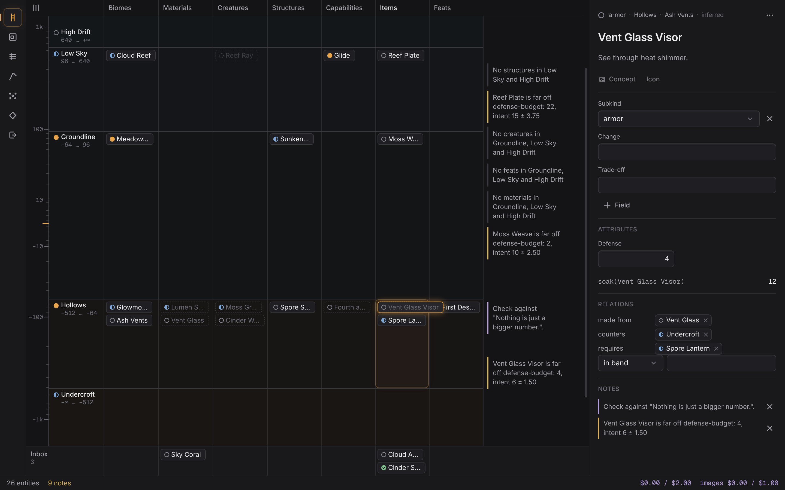

# carbon

A live design studio for [Infinite](https://github.com/Baladoodle/infinite),
with AI built in. The world bible (bands, biomes, materials, creatures,
structures), the progression (capabilities, items, feats) and the numbers that
hold them together are designed here from scratch. Claude Code implements the
exported specs in Infinite.

> Carbon is for design. Claude Code is for implementation. Infinite is the game.
> Carbon exports specs. It doesn't read Infinite and never writes to it.



**Using it:** [docs/GUIDE.md](docs/GUIDE.md) covers installing on Omarchy, the
first five minutes, every view, every key, the AI, where your data lives and
the known limitations. In short:

```sh
npm ci && npm run dist && scripts/install-omarchy.sh --hypr && carbon
```

**Developing it:**

```sh
npm run dev:sample     # the app on a scratch copy of the sample world, fake AI
npm run dev            # the app on ~/infinite-bible (or --world <dir>)
npm run check          # lint, format, types, unit tests, e2e smoke
npm run test:e2e       # the full end-to-end suite
npm run guide:keys     # regenerate the key table in docs/GUIDE.md
```

| Document | What it covers |
|---|---|
| [docs/GUIDE.md](docs/GUIDE.md) | The user guide: install, first steps, views, keys, AI, data, limitations |
| [docs/AI-FIRST-RUN.md](docs/AI-FIRST-RUN.md) | The first run against the real API: what to type, what it costs |
| [docs/PRODUCT.md](docs/PRODUCT.md) | What carbon is, why it's a native app, and how it's separate from Claude Code |
| [docs/EXPERIENCE.md](docs/EXPERIENCE.md) | Views, moves, triage, card lifecycle, keyboard |
| [docs/SYSTEM.md](docs/SYSTEM.md) | Architecture, domain model, store, commands and undo, numbers engine, AI gateway, evals, testing |
| [docs/VISUAL.md](docs/VISUAL.md) | The visual design: the text rule, colour, type, components, signature details |
| [docs/BUILD.md](docs/BUILD.md) | The overnight build: phases, work packages, rules, coordinator protocol |
| [design/mockups.html](design/mockups.html) | v1 layout reference only (visuals superseded by VISUAL.md) |
