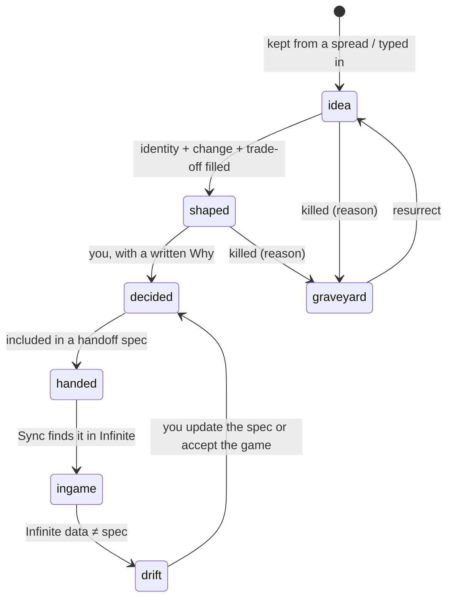

# Carbon: the experience

How carbon looks, moves and feels. The mockups are in [`design/mockups.html`](../design/mockups.html).

---

## 1. The window

```
┌──┬──────────────────────────────────────────────────────────┬──────────────┐
│1 │                                                          │              │
│2 │                     main view                            │   Bench      │
│3 │      (Column · Spread · Curves · Taste · Handoff)        │  (the card   │
│4 │                                                          │   in focus)  │
│5 │                                                          │              │
├──┴──────────────────────────────────────────────────────────┴──────────────┤
│ status: Infinite @ 52e6547 · 41 cards · 3 pressure · spend $4.10 / $100    │
└────────────────────────────────────────────────────────────────────────────┘
```

- **Rail (left):** five views, keys `1` to `5`.
- **Main view:** one at a time.
- **Bench (right):** the card in focus. It's always available and toggles with `b`.
- **Status line:** which Infinite revision carbon is reading, the card count, open
  pressure notes and API spend.
- No title bar and no decorations: Hyprland tiles it. Colours come from the
  active Omarchy theme.

## 2. The Column (home, `1`)

Infinite's Y axis as a vertical strip. This is the view that only makes sense
for Infinite.

**The axis**

- It uses a **symmetric log scale** around Y 0. The authored bands (±1000) get
  most of the height. Underworld and islands (±4 km) and the far reaches (±20 km
  and beyond) fit above and below them, compressed.
- **Bands** are horizontal strips, read from `assets/strata_layers.ron`: The Crush,
  The Hollows, The Shallows, Surface, Low Sky, Cloud Floor, Island Belt, The Thin.
  Unauthored heights are drawn as hatched **unwritten** zones that run off the
  top and bottom of the view.
- The **danger envelope** is drawn faintly behind everything: the ± band that
  `danger()` spans at each height (±0.22 at the surface, ±0.62 at 20 km). It's a
  reminder that height multiplies a place's character rather than acting as a ladder.

**Lanes** (columns across the strip):

| Lane | Holds |
|---|---|
| Capabilities | what the player can now *do* |
| Armor | head, chest, legs |
| Accessories | the slotted pieces |
| Tools and weapons | including tiers |
| Feats | deeds that unlock slots and other reveals |
| Threats | read-only: mobs from `mobs.ron`, with their `menace` |

**Cards on the Column** are small glyphs showing their state (§6). Hovering shows
a summary and `enter` opens the card in the Bench. Cards already in the game get
a solid edge, decided cards a bright fill, and ideas an outline.

**Pressure notes** sit in the right margin at the height they're about: "No
capability between Y 240 and Y 780", "The sky has 2 accessories, the depths
have 9", "3 Hollows accessories are all about light". Clicking one opens a spread
aimed at that gap.

**Navigation:** `j`/`k` scroll the height, `h`/`l` move between lanes, `+`/`−`
zoom, `0` returns to the surface. Selecting any empty cell and pressing `space`
opens a spread there.

## 3. Spreads (`2`)

How carbon generates ideas. A spread is **a spot, a move and an optional
direction**. The answer is 8 to 24 cards laid out on a field.

### Spot

The place it's aimed at: a cell on the Column (lane × band), an existing card,
a pair of cards, a pressure note or the whole Column.

### Moves

| Key | Move | What it asks for |
|---|---|---|
| `f` | **Fill** | Candidates for an empty spot, built to fit their neighbours |
| `v` | **Vary** | Siblings of one card: same purpose, different identity |
| `o` | **Oppose** | The strongest inversion of a card or a rule |
| `a` | **Alloy** | Combines two cards into something neither is |
| `p` | **Push** | The same card at 10× strength, weirdness or cost |
| `g` | **Ground** | Ties a card to a band, biome, material or threat: where it comes from, and why there |
| `c` | **Cost** | Two or three acquisition routes, with their total effort |
| `r` | **Break** | Exploits: degenerate combinations, stat stacking, trivialised bands |
| `n` | **Name** | A naming pass consistent with Infinite's voice ("Bellwether", "The Thin", "Hanging Archive") |

**Direction** is a single line ("more about sound", "no combat", "something you
would only find by accident"). It's not a chat.

### The field

Candidates are placed on a 2D field. You choose the axes, with defaults per move:

- power ↔ utility
- common ↔ exotic
- simple ↔ fiddly
- depth-flavoured ↔ sky-flavoured

Clusters show which ideas are really the same idea. One slot is always a
**wildcard**, generated without taste rules and marked as such.

### Triage

| Key | Does |
|---|---|
| `k` | **Keep**: becomes an *idea* card at the spot |
| `x` | **Kill**: asks for a reason with one key (below) |
| `m` | **Merge**: mark two or more and they combine into one card |
| `→` | **Follow**: a new spread from this card, move chosen next |
| `space` | Peek at the full card |
| `u` | Undo |

**Kill reasons** (one key each; editable in Taste):

- `1` just a number
- `2` seen it (a direct lift from another game)
- `3` off-tone
- `4` wrong band
- `5` fiddly
- `6` redundant
- `7` breaks canon
- `0` other (type a few words)

A spread ends when every card is kept, killed or left. Cards left undecided go
into a "maybe" tray attached to the spread.

## 4. The Bench (`b`, or `enter` on any card)

One card's sheet. Every field can be edited and anything Claude contributed is
marked.

| Section | Contents |
|---|---|
| **Identity** | Name, a one-line fantasy ("you hear the cave before you see it"), lane, band |
| **Change** | The *verb*: what the player can now do, or do differently. It has to be more than a number. |
| **Numbers** | Stats, with live consequences next to each (e.g. defense → damage taken at each band for a reference hit) |
| **Trade-off** | What it costs to wear or use: a slot, weight, a downside, an opportunity cost |
| **Route** | Source → process → station → total effort (travel, collection, processing) |
| **Moment** | The scene where the player gets it, and what they do in the next ten minutes |
| **Relations** | Supersedes / combines with / conflicts with / required by |
| **Why** | Your reasons for its current state. Required when you mark it *decided*. |
| **Sync** | Read-only: whether it's in Infinite, and any drift between the spec and the game |

Every section header has an inline **move** button (Vary this trade-off, Cost
this route, Name this) that opens a small spread aimed at just that field.

## 5. Curves (`3`)

The numbers lab. The curves:

- **Mitigation:** `taken = raw · k / (k + defense)`, with `k` read from
  `combat.ron`. The x axis is total defense on a log scale up to six figures.
  Every armor set and decided card is a dot on the curve.
- **Power budget by band:** the intended total defense, damage and health at each
  band. You draw it as a curve, and the cards show as dots above or below it.
- **Time to kill:** a reference mob at each band against each tier of weapon.
- **Effort by band:** total effort for each tier's materials.

You can drag control points on the intended curve. Dots that drift too far from
it turn into pressure notes. Nothing here changes the game: it changes the
*intent*, which then goes into specs.

## 6. Card lifecycle



The graveyard is searchable and shows on the Column as faint ghosts when you
choose to display it. Ideas you killed are still information.

## 7. Taste (`4`)

Your taste, written down where you can read it.

- **Canon:** rules imported from Infinite's docs, with links back to where they
  came from. For example:
  - Mining is never hard-blocked.
  - Sky and depth have equal progression importance.
  - New regions don't invalidate everything you own.
  - Capabilities come first, and a recipe is just one way to get them.
  - Height multiplies a place's character; it isn't a ladder.
  - The inventory never shows how many accessory slots there can be.
- **Rules:** your own, written or promoted from patterns. For example: "No pure
  +stat accessories" or "Every sky piece has a depth counterpart".
- **Patterns:** what carbon has noticed from your kills and keeps, each with
  examples. You can promote a pattern to a rule or dismiss it.
- **Kill reasons:** the reason vocabulary and how often each is used over time.

Each rule can be switched on or off per spread.

## 8. Handoff (`5`)

Turns decided cards into a spec.

1. Pick decided cards (by system, band or hand-picked).
2. Carbon writes `handoff/2026-11-04-first-accessories.md`. It contains a summary,
   then for each card its identity, change, numbers, trade-off, route, relations
   and why. It ends with acceptance questions Claude Code can test against.
3. You read it, edit it and mark it *handed*.
4. In a Claude Code terminal: `implement ../carbon/handoff/2026-11-04-first-accessories.md`.
5. Later, Sync reads Infinite's RON files, marks the cards *in game*, and flags
   any drift.

Carbon never opens a pull request, never writes to Infinite and never calls
Claude Code.

## 9. A session

> You open `carbon` on workspace 4. The status line says Infinite has moved 6
> commits since yesterday and one card has drifted. You glance at it: the
> spec said iron leggings defense 8, the game has 8. That's fine; it was a
> bronze piece. Accept.
>
> The Column shows the Accessories lane empty above the Surface, and a pressure
> note: *"The sky has no accessories; the depths have 4."* Press `space` on
> Low Sky × Accessories, then `f`, with the direction "something about falling".
> Sixteen cards spread across a power↔utility field. Kill five as `1` (just a
> number), two as `2` (seen it). Keep three. Two of the kept ones are close, so
> `m` merges them. The third goes to `→ o`: oppose it. One of the opposites is
> better than the original. Keep it, open the Bench, write the trade-off
> yourself, then `c` for routes.
>
> Twenty minutes in, three sky accessories are *shaped*, one is *decided* with a
> Why. The Taste view shows a new pattern, "you kill anything that only reduces
> fall damage", ready to promote to a rule.

## 10. Keyboard

| Key | Everywhere |
|---|---|
| `1`–`5` | Column, Spread, Curves, Taste, Handoff |
| `b` | Toggle Bench |
| `/` | Search all cards, including the graveyard |
| `i` | Inbox (cards without a place) |
| `space` | Spread at the selection |
| `f v o a p g c r n` | Moves |
| `k x m →` | Triage |
| `d` | Mark decided (asks for Why) |
| `?` | All keys |
