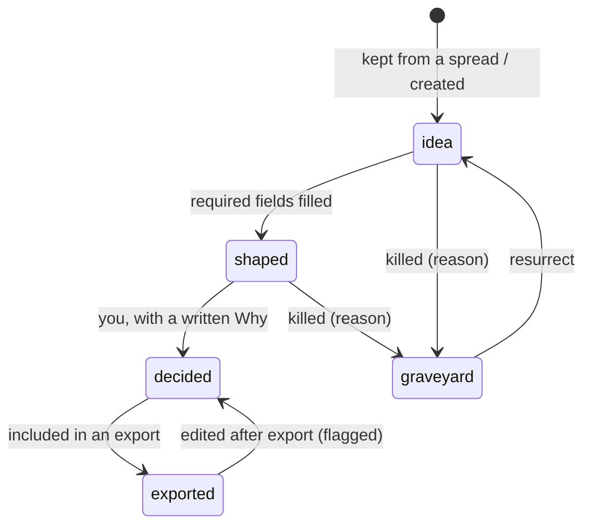

# Carbon: the experience

How carbon looks and behaves. [`design/mockups.html`](../design/mockups.html)
shows the v1 visual direction (layout, Column, spread, Bench, curves, Taste). It
predates the from-scratch world bible, so its references to reading Infinite no
longer apply.

---

## 1. The window

```
┌──┬────────────────────────────────────────────────┬──────────────┐
│ 1│                                                │              │
│ 2│                 main view                      │    Bench     │
│ 3│                                                │  (entity in  │
│ 4│                                                │    focus)    │
│ 5│                                                │              │
│ 6│                                                │              │
├──┴────────────────────────────────────────────────┴──────────────┤
│ world: ~/infinite-bible · 212 entities · 4 notes · AI $0.84 · ⟳ saved │
└──────────────────────────────────────────────────────────────────┘
```

- **Rail:** the main views, keys `1` to `7`.
- **Bench:** the entity in focus. Toggle it with `b`.
- **Status line:** the world directory, the entity count, open notes, AI spend
  this session, save state.
- **Command palette** (`ctrl+k`): every action and every entity, searchable.
- No frame; Hyprland tiles the window. Colours follow the Omarchy theme.

## 2. Views

### Column (`1`)

Infinite's Y axis as a vertical strip: a symmetric log scale around 0, endless
in both directions. **Bands** are horizontal strips you create and resize by
dragging their edges. Heights with no band are hatched as *unwritten*.

**Lanes** across the strip:

| Lane | Holds |
|---|---|
| Biomes | biomes in each band |
| Materials | materials, placed where they're found |
| Creatures | creatures, placed where they live |
| Structures | structures |
| Capabilities | capabilities: what the player can now *do* |
| Items | items, grouped by subkind: armor, accessories, tools, weapons, consumables |
| Feats | feats |

- You choose which lanes to show and their order, and save the arrangement as a
  layout.
- An entity's height comes from its relations: a material is wherever the
  biomes it's found in are, and an item is where its route says you get it.
  Entities with no explicit place show where they're inferred to be, marked
  *inferred*.
- **Notes** (mechanical checks and AI critique) sit in the right margin at their
  height.
- **Navigation:** `j`/`k` move up and down, `h`/`l` between lanes, `+`/`−` zoom,
  `0` jumps to Y 0. `n` creates an entity in the selected cell. `space` starts a
  spread there.

### Climate (`2`)

One band at a time. Its biomes are regions on a temperature × moisture plane,
which you drag to move and resize. Overlaps and empty climate show at a glance.
Each biome region lists its signature materials, creatures and structures.
`[` and `]` switch band.

### Codex (`3`)

Every entity as a table, one tab per kind. Columns are fields and attributes;
you can sort, filter (`state:decided band:"Low Sky" lane:items`) and edit inline.
This is where bulk work happens. Selecting rows and pressing `space` starts a
spread over them (for example, Name or Vary).

### Numbers (`4`)

The numbers layer:

- **Variables:** `k = 100`, `base_health = 100`.
- **Attributes on entity kinds:** for example, armor has `defense: number`.
- **Formulas:** written in carbon's expression language,
  `taken(raw, def) = raw * k / (k + def)`.

Each formula has a live preview and **curves**: plot a formula against height,
tier or an attribute, with entities as dots. Intent curves can be dragged.
Errors (an unknown name, a cycle, a type mismatch) show inline as you type,
because they're computed locally.

### Spread (`5`)

Generation you start yourself (§4).

### Taste (`6`)

Your rules, kill reasons and learned patterns (§6).

### Export (`7`)

Specs for Claude Code (§7).

**AI log** (`ctrl+l`, an overlay): every AI call with its trigger, entity,
tokens, cache hits, cost, latency and result. You can open the request it sent.

## 3. The Bench

One entity, rendered from its kind's schema:

- the kind's fields: name, one-line identity, description, change, trade-off,
  moment, and so on
- attributes (numbers) with their live consequences
- relations (typed, with an entity picker)
- the state: idea, shaped, decided, exported, or graveyard
- **Why**, which is required to mark the entity decided
- notes on this entity

Fields written by the AI carry a small `ai` marker until you edit them.
Everything is undoable with `ctrl+z` / `ctrl+shift+z`, including accepted
suggestions and AI-applied changes.

## 4. Spreads

A spread is a **spot**, a **move** and an optional one-line **direction**.

- **Spot:** a Column cell, a Climate region, entities selected in the Codex, a
  single entity or a note.
- **Moves:**

| Key | Move | Asks for |
|---|---|---|
| `f` | Fill | candidates for an empty spot, built to fit their neighbours |
| `v` | Vary | siblings of an entity: same role, different identity |
| `o` | Oppose | the strongest inversion of an entity or a rule |
| `a` | Alloy | two entities combined into something neither is |
| `p` | Push | the same thing at 10× strength, weirdness or cost |
| `g` | Ground | ties an entity to bands, biomes, materials and creatures, with reasons |
| `c` | Cost | 2 or 3 acquisition routes with their total effort |
| `r` | Break | exploits, degenerate combinations, trivialised bands |
| `n` | Name | a naming pass in the world's own voice |

- **Output:** 8 to 16 candidates **streamed** onto a field with two axes you
  choose. One of them is a wildcard generated without your taste rules.
- **Triage:**
  - `k` keep, as an idea at the spot
  - `x` kill, followed by a one-key reason
  - `m` merge marked candidates
  - `→` follow with another move
  - `u` undo
- **Kill reasons** (editable in Taste):
  1. just a number
  2. seen it
  3. off-tone
  4. wrong place
  5. fiddly
  6. redundant
  7. breaks a rule
  0. other (type a few words)

## 5. When the AI runs

The AI runs only at these moments. Nothing else calls the API.

| Moment | Trigger | Requests | Result |
|---|---|---|---|
| **Suggest one** | `tab` on a focused field | 1 | One grey suggestion in the field. `tab` accepts, `tab` again gives another, `esc` dismisses |
| **Suggest three** | `shift+tab` on a focused field | 1 | Three alternatives under the field. `1`/`2`/`3` picks one, `esc` dismisses |
| **Fill entity** | `ctrl+enter` on the Bench | 1 | Proposals for every empty field of the entity, each accepted or rejected on its own |
| **Critique** | When you **finish editing** an entity (focus leaves it after changes, or `ctrl+s`), when its state changes, or on demand (`?`) | 1 | Notes on the entity: just a number, clashes with a rule, duplicates another entity, contradicts a relation, weak identity |
| **Spread** | You start one | 1 (streamed) | Candidates on the field |
| **Patterns** | After every 25 judgements, or on demand in Taste | 1 | New or updated patterns for you to promote or dismiss |
| **Spec draft** | Export | 1 per spec | A markdown spec for you to edit |

Rules for all of them:

- **Content-hash cache.** A critique of an unchanged entity, with unchanged
  context and taste, is never sent twice.
- **One request at a time per entity.** A new trigger cancels the stale one.
- **Mechanical checks** (an empty lane run, a dangling relation, a material
  found nowhere, a formula error, an imbalance between depth and sky) run
  locally on every change, at no cost. They're not AI.
- **Visible cost.** Every result shows its cost in the AI log. The status line
  shows session spend against the budget in settings.
- **Off switch.** `ctrl+shift+a` turns all AI off for the session.

## 6. Taste

- **Rules** you write, each switchable on or off per spread.
- **Kill reasons:** the vocabulary, and how often each is used.
- **Patterns:** learned from your keeps and kills, each with its examples, for
  you to promote to a rule or dismiss.

Active rules, the top patterns and examples of kill reasons go into every AI
request.

## 7. Export

Choose decided entities (by kind, band or hand-picked). Carbon drafts
`exports/YYYY-MM-DD-<name>.md` containing a summary, each entity with its fields,
attributes, relations and why, the formulas they depend on, and acceptance
questions for Claude Code to test against. You edit it, and the entities are
marked *exported*. Carbon never opens a pull request and never calls Claude Code.

## 8. Lifecycle



## 9. Keyboard

| Key | Action |
|---|---|
| `1`–`7` | views |
| `b` | toggle Bench |
| `ctrl+k` | command palette |
| `/` | search |
| `i` | Inbox |
| `n` | new entity at selection |
| `space` | spread at selection |
| `tab` / `shift+tab` | suggest one / three |
| `ctrl+enter` | fill entity |
| `?` | critique now |
| `d` | mark decided (asks for Why) |
| `ctrl+z` / `ctrl+shift+z` | undo / redo |
| `ctrl+l` | AI log |
| `ctrl+shift+a` | AI off for the session |
