# Carbon: the guide

How to install carbon on Omarchy, use it, and keep its data safe. What carbon
is and why: [`PRODUCT.md`](PRODUCT.md). How it behaves in detail:
[`EXPERIENCE.md`](EXPERIENCE.md).

---

## 1. Install on Omarchy

You need `git`, Node 22 or newer and npm (`sudo pacman -S git nodejs npm`).
`npm ci` and `npm run dist` download Electron, so they need the network once.

```sh
git clone https://github.com/Baladoodle/carbon.git ~/src/carbon
cd ~/src/carbon
npm ci                              # about a minute
npm run dist                        # about two minutes: dist/linux-unpacked/ and an AppImage
scripts/install-omarchy.sh --hypr   # the app, the `carbon` command, the window rule
carbon
```

What the installer writes (`--dry-run` shows it first; running it again
changes nothing):

| Path | What |
|---|---|
| `~/.local/share/carbon/app/` | the app: the unpacked build, preferred because it needs no FUSE |
| `~/.local/bin/carbon` | the launcher: focuses the running carbon through `hyprctl`, or starts it |
| `~/.local/share/applications/carbon.desktop` | the desktop entry, so the launcher menu finds it |
| `~/.config/hypr/carbon.conf` | the window rule: carbon on a workspace of its own, tiled, in the syntax of the Hyprland it finds |
| `~/.config/hypr/hyprland.conf` | with `--hypr` only: one `source =` line for the rule, marked as the installer's |

- If the installer says `~/.local/bin` isn't on your `PATH`, add
  `export PATH="$HOME/.local/bin:$PATH"` to `~/.bashrc`.
- Hyprland reloads its config when the file changes; if the rule doesn't take,
  run `hyprctl reload`.
- To install the AppImage instead: `scripts/install-omarchy.sh --appimage dist/carbon-*.AppImage`.
  It needs `libfuse.so.2` (`sudo pacman -S fuse2`); the installer warns when
  it's missing.
- **Update:** `git pull && npm ci && npm run dist && scripts/install-omarchy.sh`.
- **Remove:** `scripts/install-omarchy.sh --uninstall`. It removes only what it
  wrote. Worlds and settings stay.

### The world directory

Carbon edits one world directory. The first start creates it and makes it a
git repository.

| Where it looks, in order | |
|---|---|
| `carbon --world <dir>` | for this run |
| `CARBON_WORLD_DIR` | in the environment |
| `worldDir` in `~/.config/carbon/settings.json` | e.g. `{ "worldDir": "~/worlds/infinite" }` |
| `~/infinite-bible` | the default |

The directory is an ordinary git repository: push it to a private remote for
an off-machine backup (`git remote add origin …`, `git push`). Carbon commits
to it (§6) but never pushes.

### The API key

Without a key the AI is off and everything else works. To turn it on, store
the key in the keyring once (`secret-tool` comes with `libsecret`):

```sh
secret-tool store --label='carbon: Anthropic API key' service carbon account anthropic-api-key
```

`ANTHROPIC_API_KEY` in the environment works too. The first real run, what it
costs and what to check: [`AI-FIRST-RUN.md`](AI-FIRST-RUN.md).

## 2. The first five minutes

A new world is empty, and each view says what's missing and the key that
fixes it.

1. **Bands first.** On the Column (`1`), press `n`: a band around Y 0. Type its
   name, `enter`. `k` moves the cursor into the unwritten height above it, `j`
   below; `n` there writes the next band. A band's Bottom or Top can be `∞` or
   `−∞` (type `inf`, `-inf`) for the endless ends. Drag a band's edge on the
   ruler to resize it, or draw a new band by dragging in a hatched gap.

   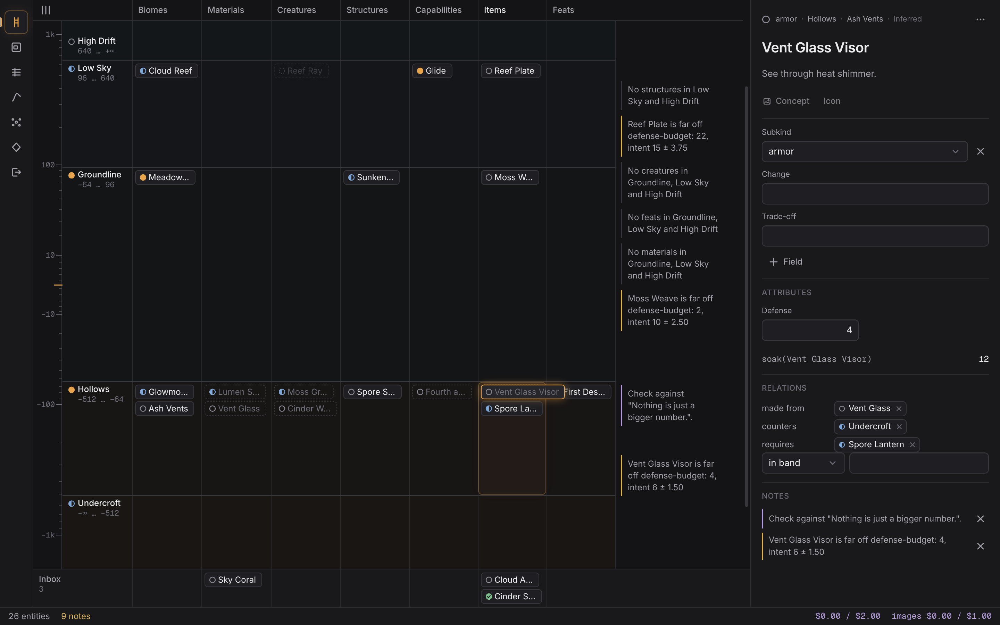

2. **Biomes in Climate.** `2`, pick the band's tab, `n`: a biome in the
   emptiest climate, its name ready to type. Drag it to move, drag its corners
   to resize, or nudge it with the arrows (`shift` + arrows resize).

   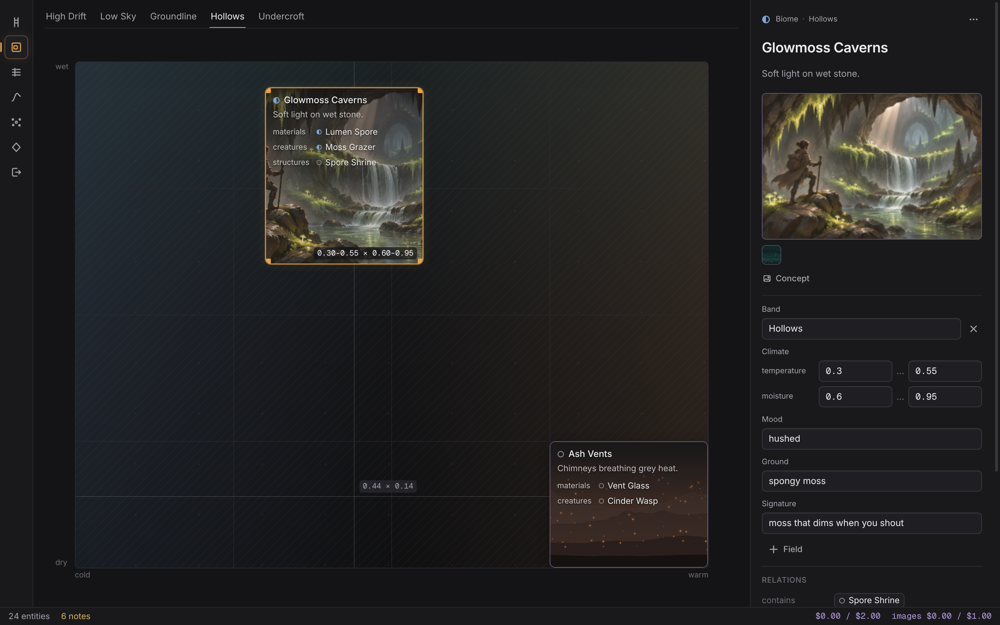

3. **What lives there.** Back on the Column, click a cell (a band's row in a
   lane: Materials, Creatures, …) and press `n`. The Bench on the right holds
   the new entity. Relate it at the bottom of the Bench: pick a type ("found
   in", "lives in", "drops"), then the target. A material found in a biome
   shows in that biome's band, marked *inferred*.

   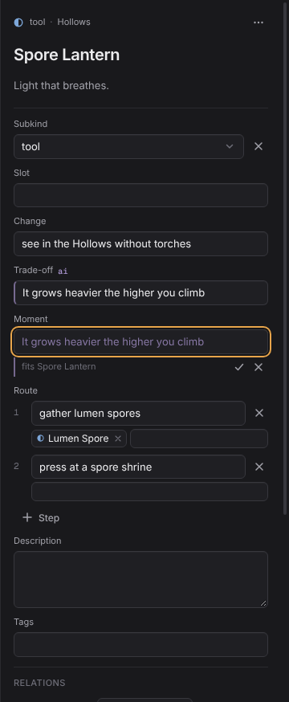

4. **Ask for candidates.** With the cursor on a cell, `space` opens a spread
   aimed at it. `enter` runs it. `k` keeps a candidate as an idea, `x` kills
   it and asks for a reason (one key), `u` undoes.

   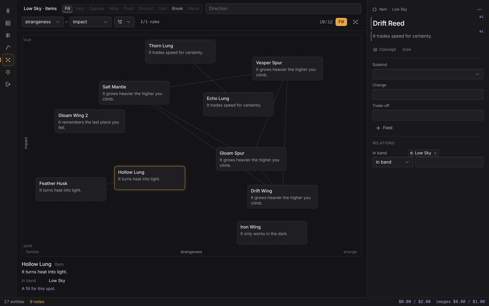

5. **Find anything.** `ctrl+k` searches every entity and every action you can
   run now, each shown with its key.

   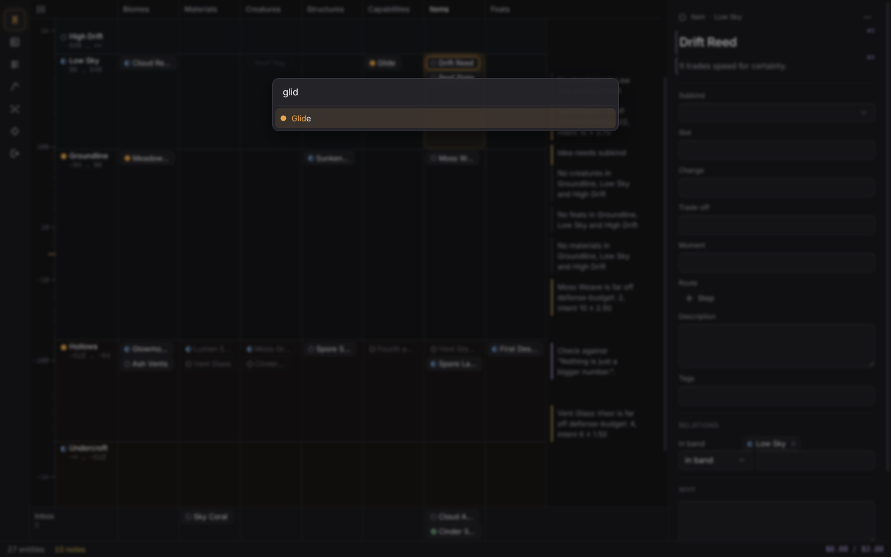

`ctrl+z` undoes anything, AI changes included; `ctrl+shift+z` redoes.

## 3. The views

**Column (`1`).** Infinite's Y axis on a symmetric log scale, endless both
ways. Bands are rows; lanes are columns, one per kind (items grouped by
subkind). An entity sits where its relations place it; one with no place
waits in the Inbox at the bottom (`i`). Notes (mechanical checks, critique)
sit in the right margin at their height; click one to open its entity. The
lane menu (top left) hides, shows and orders lanes and saves layouts.

**Climate (`2`).** One band at a time (`[`, `]` or the tabs). Each biome is a
rectangle on temperature (cold to warm) × moisture (dry to wet). Overlapping
biomes are flagged, and climate no biome covers is hatched. A region lists
what lives in it.
`space` aims a spread at the selected region.

**Codex (`3`).** Every entity as a table, a tab per kind. `/` filters with the
query language (`state:idea band:"Low Sky" lane:items`, free words match
names). `enter` edits a cell. `x` selects rows, `shift+j`/`shift+k` extend the
selection, `ctrl+a` selects every row shown. `s` sets the state of the
selection, `d` decides it, `space` spreads over it. Bulk actions reach only
the selected rows the filter shows; the bar counts the hidden ones.

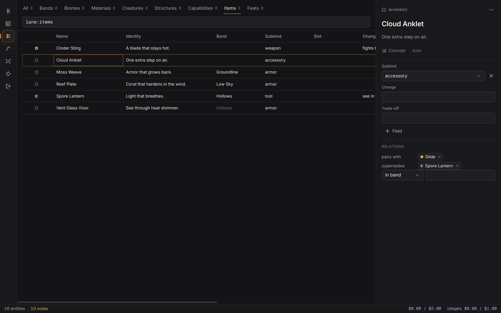

**Numbers (`4`).** Formulas on the left, in carbon's expression language
(`taken(raw, def) = raw * k / (k + def)`), each line's value or type beside it,
errors marked as you type. Variables (`v`) and attribute definitions per kind
(`a`) on the right. Curves (`c`) plot a formula over bands, tiers or an
attribute, with entities as dots. Double-click a plot to start an intent
curve; drag its points, or focus one and use the arrows, `+` and `delete`. An
entity far off its intent raises a note.

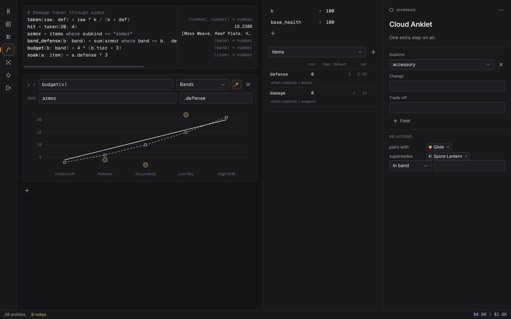

**Spread (`5`).** A spot (`s` to change it), a move (`f` Fill, `v` Vary, `o`
Oppose, `a` Alloy, `p` Push, `g` Ground, `c` Cost, `r` Break, `n` Name) and an
optional direction (`e`). `enter` streams 8 to 16 candidates onto the field;
the two axes are yours to choose. One candidate, marked ✲, ignores your taste
rules. Triage with `k`, `x`, `space` and `m` (merge marked), `→` (follow with
another move) and `u`.

**Taste (`6`).** Your rules (each on or off per spread), the kill-reason
vocabulary with how often each is used, and patterns learned from your keeps
and kills. Learning runs every 25 judgements, or now with `shift+l`; promote a
pattern to a rule (`p`) or dismiss it (`d`).

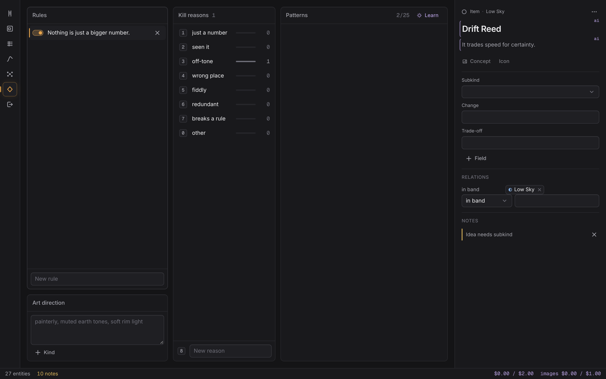

**Export (`7`).** Choose decided entities by kind, band or by hand (`space`).
`ctrl+enter` drafts the spec with the AI; without it, or from the palette's
"Use the spec template", you get the deterministic spec (fields, route,
attributes, relations, why, the formulas they read, acceptance questions).
Edit it, then `ctrl+s` writes `exports/YYYY-MM-DD-<name>.md` and marks the
entities exported, as one undo step. An exported entity edited later is marked
with a dot.

**The Bench (`b` shows or hides it).** One entity: name, identity, the fields
its state needs, attributes with their live consequences, relations, Why,
notes. Empty optional fields wait behind `+ Field`. The `…` menu moves it
through idea → shaped → decided (`d`, with a Why) → exported, or to the
graveyard with a reason; the glyph by the kind shows where it is. Fields the AI wrote carry
an `ai` marker until you edit them.

**The AI log (`ctrl+l`).** Every AI call this session: moment, entity, tokens,
cache reads, cost, latency, result. `enter` on a row shows the request sent.

## 4. Keys

Generated from carbon's action registry; `e2e/keys.spec.ts` fails when this
table and the app disagree. A view's key wins over the Bench's while you're in
the view (in Taste, `d` dismisses the pattern), unless focus is in the Bench.

<!-- keys:start (generated by `npm run guide:keys` from the action registry) -->

#### Anywhere

| Key | Action |
|---|---|
| `1` | Go to Column |
| `2` | Go to Climate |
| `3` | Go to Codex |
| `4` | Go to Numbers |
| `5` | Go to Spread |
| `6` | Go to Taste |
| `7` | Go to Export |
| `b` | Toggle the Bench |
| `ctrl+k` | Command palette |
| `ctrl+l` | AI log |
| `ctrl+shift+a` | Turn AI off / on for the session |
| `ctrl+z` | Undo |
| `ctrl+shift+z` or `ctrl+y` | Redo |
| `escape` | Close |

#### Column

| Key | Action |
|---|---|
| `j` or `↓` | Move down |
| `k` or `↑` | Move up |
| `h` or `←` | Lane left |
| `l` or `→` | Lane right |
| `+` or `=` | Zoom in |
| `-` | Zoom out |
| `0` | Jump to Y 0 |
| `n` | New entity here |
| `space` | Spread here |
| `enter` | Edit on the Bench |
| `i` | Inbox |
| `alt+k` | Raise the top edge of the band |
| `alt+j` | Lower the top edge of the band |
| `alt+shift+k` | Raise the bottom edge of the band |
| `alt+shift+j` | Lower the bottom edge of the band |
| `alt+h` | Move this lane left |
| `alt+l` | Move this lane right |

#### Bench

| Key | Action |
|---|---|
| `tab` | Suggest one |
| `shift+tab` | Suggest three |
| `1` | Pick suggestion 1 |
| `2` | Pick suggestion 2 |
| `3` | Pick suggestion 3 |
| `escape` | Dismiss the suggestion |
| `ctrl+enter` | Fill empty fields |
| `?` | Critique now |
| `ctrl+s` | Finish editing |
| `d` | Mark decided… |
| `alt+↓` | Next field |
| `alt+↑` | Previous field |

#### Climate

| Key | Action |
|---|---|
| `[` | Previous band |
| `]` | Next band |
| `j` | Next biome |
| `k` | Previous biome |
| `→` | Move the biome warmer |
| `←` | Move the biome colder |
| `↑` | Move the biome wetter |
| `↓` | Move the biome drier |
| `shift+→` | Widen the biome (warmer edge) |
| `shift+←` | Narrow the biome (warmer edge) |
| `shift+↑` | Raise the biome’s wet edge |
| `shift+↓` | Lower the biome’s wet edge |
| `n` | New biome in the emptiest climate |
| `enter` | Open the biome on the Bench |
| `escape` | Deselect |
| `space` | Spread in this climate |

#### Codex

| Key | Action |
|---|---|
| `j` or `↓` | Next row |
| `k` or `↑` | Previous row |
| `shift+j` or `shift+↓` | Extend selection down |
| `shift+k` or `shift+↑` | Extend selection up |
| `g` or `home` | First row |
| `shift+g` or `end` | Last row |
| `h` or `←` | Previous column |
| `l` or `→` | Next column |
| `[` | Previous kind |
| `]` | Next kind |
| `enter` | Edit cell |
| `x` | Select row |
| `ctrl+g` | Generate concept: the cursor row, or a batch over the selected rows shown |
| `ctrl+shift+g` | Generate icon: the cursor row, or a batch over the selected rows shown |
| `ctrl+a` | Select all rows |
| `escape` | Clear selection |
| `/` | Filter |
| `o` | Sort by column |
| `>` | Widen column |
| `<` | Narrow column |
| `s` | Set state |
| `d` | Mark decided |
| `n` | New entity |
| `p` | Pin placement |
| `shift+p` | Unpin placement |
| `space` | Spread over selection |

#### Codex: the state dialog (`s`)

| Key | Action |
|---|---|
| `i` | idea |
| `s` | shaped |
| `d` | decided |
| `e` | exported |
| `g` | graveyard |

#### Kill reasons (the defaults; after `x` in a spread, `g` in the state dialog)

| Key | Action |
|---|---|
| `1` | just a number |
| `2` | seen it |
| `3` | off-tone |
| `4` | wrong place |
| `5` | fiddly |
| `6` | redundant |
| `7` | breaks a rule |
| `0` | other |

#### Images (in every view)

| Key | Action |
|---|---|
| `ctrl+g` | Generate concept: the entity in focus, or a batch over a multi-selection |
| `ctrl+shift+g` | Generate icon: the entity in focus, or a batch over a multi-selection |

#### Numbers

| Key | Action |
|---|---|
| `a` | New attribute |
| `v` | New variable |
| `c` | New curve |
| `e` | Edit formulas |
| `ctrl+space` | Complete the name |
| `ctrl+z` | Undo typing |

#### Spread

| Key | Action |
|---|---|
| `f` | Move: Fill |
| `v` | Move: Vary |
| `o` | Move: Oppose |
| `a` | Move: Alloy |
| `p` | Move: Push |
| `g` | Move: Ground |
| `c` | Move: Cost |
| `r` | Move: Break |
| `n` | Move: Name |
| `enter` | Start the spread |
| `s` | Change the spot |
| `e` | Edit the direction |
| `escape` | Stop the spread |
| `tab` | Next candidate |
| `shift+tab` | Previous candidate |
| `↑` | Candidate above |
| `↓` | Candidate below |
| `←` | Candidate to the left |
| `k` | Keep |
| `x` | Kill… |
| `space` | Mark for merging |
| `m` | Merge marked |
| `→` | Follow with a move… |
| `u` | Undo |

#### Taste

| Key | Action |
|---|---|
| `h` or `←` | Previous column |
| `l` or `→` | Next column |
| `j` or `↓` | Next row |
| `k` or `↑` | Previous row |
| `n` | New rule |
| `space` | Switch the rule on or off |
| `enter` | Edit |
| `delete` or `backspace` | Remove |
| `o` | Oppose this rule in a spread |
| `p` | Promote the pattern to a rule |
| `d` | Dismiss the pattern |
| `shift+l` | Learn patterns now |

#### Export

| Key | Action |
|---|---|
| `ctrl+enter` | Draft the spec |
| `ctrl+s` | Write the export |
| `j` or `↓` | Next |
| `k` or `↑` | Previous |
| `space` or `x` | Toggle |
| `enter` | Put on the Bench |

#### AI log

| Key | Action |
|---|---|
| `escape` or `ctrl+l` | Close the AI log |
| `↓` or `j` | Next call |
| `↑` or `k` | Previous call |

<!-- keys:end -->

## 5. The AI

The AI runs only at these moments, and nothing else calls the API.

| Moment | When it runs | Requests |
|---|---|---|
| Suggest one | `tab` in a Bench field. `tab` accepts, `tab` again asks for another, `escape` dismisses | 1 |
| Suggest three | `shift+tab` in a field. `1`–`3` picks | 1 |
| Fill entity | `ctrl+enter` on the Bench: a proposal per empty field, each accepted (`tab`) or rejected on its own | 1 |
| Critique | When you finish editing an entity (focus leaves it after a change, or `ctrl+s`), when its state changes, or on `?` | 1 |
| Spread | `enter` in the Spread view | 1, streamed |
| Patterns | Every 25 judgements, or `shift+l` in Taste | 1 |
| Spec draft | `ctrl+enter` in Export | 1 per spec |

- **Cache:** a request whose content hasn't changed (entity, context, taste) is
  answered from the cache at no cost.
- **Cost:** `claude-haiku-5-5`, about $0.001 for a critique and under $0.01 for
  a spread. Every call's cost is in the AI log; the status line shows the
  session's spend against its budget.
- **Budget:** $2 per session and $20 per month by default. Click the spend in
  the status line to change it (it's kept in `carbon.json` under `ai.budget`).
  At the limit the AI pauses until you raise it.
- **Off:** `ctrl+shift+a` turns the AI off for the session. With no key it's
  off, and the status line says why.
- **Mechanical checks are not AI.** An empty lane, a dangling relation, a
  material found nowhere, a formula error, an attribute off its curve or a
  near-duplicate name are found locally on every change, for free.

The first run against the real API (`npm run smoke:ai`, `npm run eval`), what
it costs and what each result means: [`AI-FIRST-RUN.md`](AI-FIRST-RUN.md).

### Images and icons

Concept art for any entity, and 16×16 item icons in Infinite's style, from
OpenAI's Images 2.6 models (the full design is [`IMAGES.md`](IMAGES.md)).

- **Deliberate, always.** Nothing generates on its own. `ctrl+g` (concept)
  and `ctrl+shift+g` (icon) work on whatever is selected, in every view; the
  same actions are in the Climate panel's menu (right-click, or the quiet
  button on a selected panel), the Column chip's and Codex row's menus, the
  Bench's `…` menu and image strip, and the palette.
- **The confirm step comes first.** Claude writes a prompt (on Haiku, from
  the entity, its place and the art direction); you can edit it or write your
  own. Choose the model (`gpt-image-2.6-flare` by default, or `sunburst`), the
  quality (**low** by default) and the size, and see the estimated cost.
  `enter` sends it, `esc` cancels with nothing spent.

  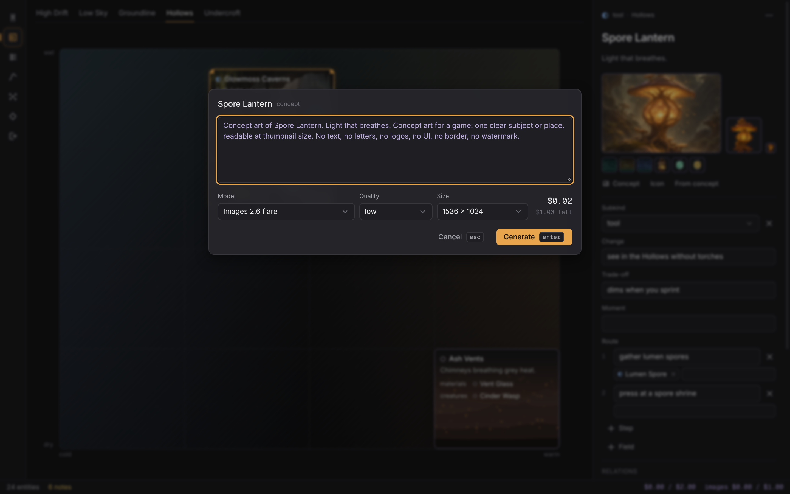

- **Where they show:** a biome's concept fills its Climate panel; the Bench
  shows the concept (click to enlarge), the icon at 1× and 4×, and earlier
  versions (click one to choose it); item chips on the Column and the Codex's
  image column show icons, always pixelated.

  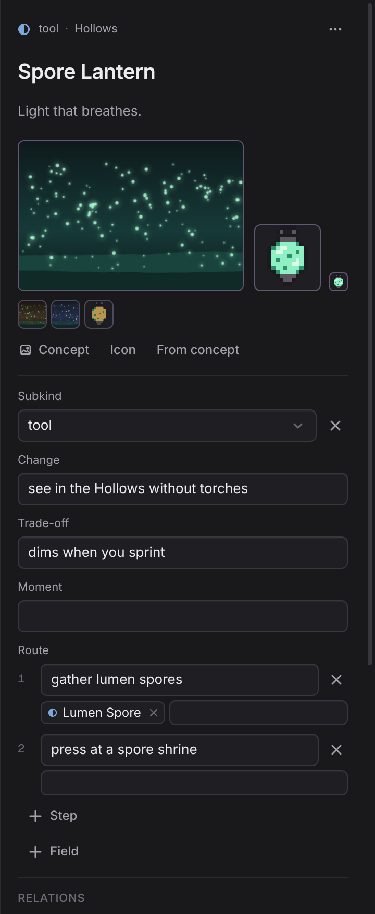

- **Icon from concept** filters the chosen concept into a 16×16 icon with
  Genforge's `item` filter. It's free: no API call.
- **Batches:** select rows in the Codex (`Concepts…` or `Icons…` in the bulk
  bar, or the key), or use the palette's "Generate icons in this cell/lane"
  on the Column. The dialog lists every prompt, each editable, with the model,
  quality, call count and estimated total, and skips entities that already
  have one unless you choose Replace. Concepts run two at a time, with
  progress, a cancel and a result per row. **Icons go out as one sheet** (up
  to 100 icons in a single call), then a review: the sheet and each cell's
  16×16 result. Unflagged cells start accepted; click a cell to accept or
  reject it, "Regenerate" makes a smaller sheet of the rejected ones, and
  "Accept" turns the accepted cells into icons, one undo step.

  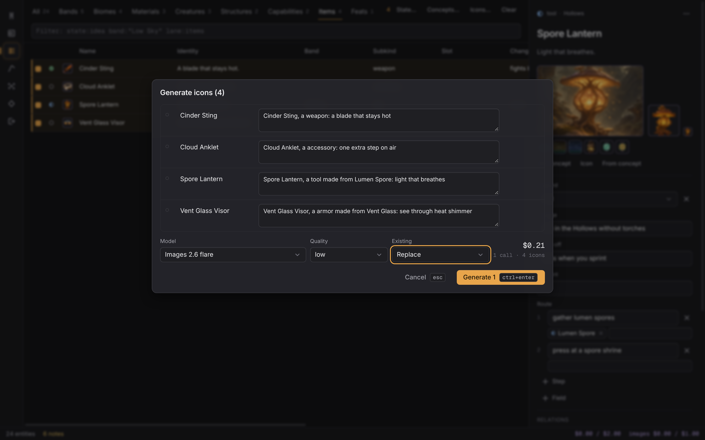

- **Undo:** choosing and removing images are ordinary undo steps. Removing
  keeps the files; "Delete image files of removed images" in the palette
  purges them, after a confirm.
- **Art direction:** Taste's Art direction section holds a paragraph for
  every image prompt, and a note per kind (`+ Kind`).
- **Cost and budget:** OpenAI's spend is in the status line beside Claude's
  (`images $0.04 / $1.00`), with its own budget ($1 per session, $10 per
  month by default; click it to change). At the limit images pause, and the
  confirm step says so. Every image call is in the AI log (`ctrl+l`), with a
  thumbnail, under its own `images` tab.
- **Export** copies each chosen entity's selected images beside the spec,
  and the preview shows them.

## 6. Where your data lives

Everything is plain files in the world directory:

| Path | What |
|---|---|
| `entities/<kind>/<id>.md` | one entity: YAML frontmatter, then its description |
| `numbers/` | `variables.json`, `formulas.carbon`, `curves.json` |
| `taste/` | `rules.json`, `reasons.json`, `patterns.json` |
| `spreads/` | every spread and its judgements |
| `exports/` | the specs you've written |
| `ai-log/<date>.jsonl` | every AI call: moment, usage, cost (no prompts unless `ai.debug` is on) |
| `carbon.json`, `schema.json` | settings; kinds and fields on top of the built-in ones |
| `.carbon/` | carbon's bookkeeping: quarantine, backups, note dismissals |

- **Saves** are immediate and atomic (write, fsync, rename): a crash never
  leaves half a file.
- **Snapshots:** carbon commits the world to git after 10 minutes without an
  edit (`snapshot.idleMinutes` in `carbon.json`) and when it quits.
  "Snapshot the world to git now" in the palette commits at once. Use `git
  log` and `git checkout <commit> -- <file>` to get anything back.
- **Editing files by hand** (or by Claude Code) is fine while carbon runs: the
  change shows within a second. If you and the file changed the same field
  within 15 seconds of each other, carbon asks which to keep; a field you're
  typing in on the Bench asks inline (Keep mine / Use theirs).
- **Backups:** before carbon upgrades a world to a newer format it copies it
  to `.carbon/backups/<time>-format-<n>/`. A world written by a newer carbon
  opens read-only.
- **Quarantine:** a file carbon can't read when it opens the world is moved to
  `.carbon/quarantine/<time>/<path>`, never dropped. The status line shows
  "N unreadable files"; click it, or "Open the quarantine folder" in the
  palette. To recover one, fix it (the status line's tooltip gives each
  file's reason) and move it back to its path in the world; carbon picks it
  up. A quarantined `carbon.json`, `schema.json` or taste file is replaced
  by its default so the world still opens.

## 7. Known limitations

Collected from the build notes and checked against the code on this build.

**Not yet tried on real hardware.** `hyprctl` against a running Hyprland, the
window rule, the desktop entry and its icon, the Wayland app id, and how Inter
and Geist Mono render at your display's scale were tested with fakes and
under Xvfb only.

**AI.**
- No request has gone to the real API yet: suggestion and critique quality is
  unmeasured until your first `npm run eval`, and `--replay` has no recorded
  answers until you record them.
- The request text in the AI log is kept for the session only, unless
  `ai.debug` is on.

**Column and Bench.**
- With every lane and the Bench open at 1440 px, long names are cut short.
  The cursor and the tooltip show them whole; hiding a lane or the Bench makes
  room.
- The scroll position resets when carbon restarts (the zoom is kept).
- Margin notes stack in order of height, so in a crowded band a note can sit
  below the entity it's about.
- Attribute rows on the Bench always show; they don't wait behind `+ Field`.

**Climate and Codex.**
- Codex columns can't be hidden or reordered, and the last column doesn't
  stretch to the pane.
- Climate and route cells can't be edited in the Codex; use Climate or the
  Bench.
- The filter has no autocomplete; after a mistake it suggests the nearest key
  or value.

**Numbers.** No go-to-definition in the formula editor.

**Spreads.** Changing the axes doesn't move candidates already on the field.
Items kept from a Fill spread have no subkind until you give them one.

**Checks and export.**
- Near-duplicate names are flagged across kinds too (a biome "Salt Flats" and
  a material "Salt Glass").
- A missing-field note names the state, not the entity ("Idea needs
  subkind"); click it to open the entity.
- An off-curve note names the curve by its id (`curve-1`), not its formula.
- The spec template's acceptance questions can end in doubled punctuation
  ("…grounds you.?").

**Store.**
- A snapshot only happens after 10 idle minutes or on quit, so a long
  unbroken session has none until you ask (palette).
- There are no format migrations yet; the machinery is tested with synthetic
  ones.
