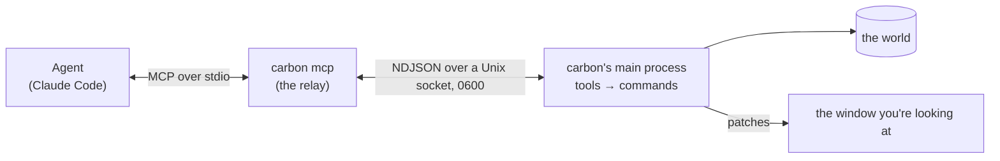
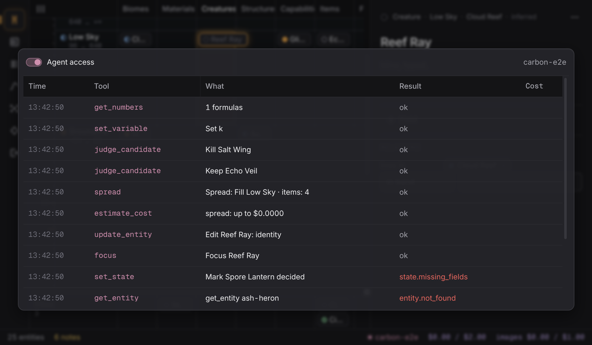

# Carbon: agents (MCP)

An agent you run (Claude Code, or any MCP client) can work with the running
carbon directly: read the world, change it through the same commands as the
UI, show you what it means, and use carbon's own AI and image generation as
tools. You watch it happen in carbon, and `ctrl+z` takes back anything it did.

Carbon doesn't provide the agent. It provides the way in.

> How this fits [`PRODUCT.md`](PRODUCT.md) §4: carbon still runs no agents of
> its own and nothing changes the world on its own. An agent is something you
> start, outside carbon, for a task you give it. Everything it does arrives
> as a command, is one undo step, is marked as the agent's, and shows in the
> Agent log. Carbon is still where you shape things; the agent is another pair
> of hands at the same bench.

---

## 1. Connecting

```sh
claude mcp add carbon -- carbon mcp
```

That's all, once carbon is installed (`scripts/install-omarchy.sh`, see
[`GUIDE.md`](GUIDE.md) §1). Start carbon, then the agent. From a checkout
instead of an install: `npm run build`, then
`claude mcp add carbon-dev -- node ~/src/carbon/scripts/carbon-mcp.mjs`.

**How it works.**



- **The running app listens on a Unix domain socket**, created mode 0600 in a
  0700 directory: `$XDG_RUNTIME_DIR/carbon/carbon.sock`, or
  `~/.config/carbon/carbon.sock` when there's no runtime directory.
  `CARBON_SOCKET` overrides both (for tests, or two carbons). A socket left by
  a carbon that crashed is replaced when carbon starts; a live one (another
  carbon answering on it) is left alone, and the status of the Agent overlay
  says so. A path there that isn't a socket is never removed.
- **`carbon mcp` is a small stdio MCP server** built with the official
  `@modelcontextprotocol/sdk`. It holds no tools of its own: it connects to
  the socket, asks the app for its tools, and relays every request. It runs
  under the installed app's own Electron in node mode
  (`ELECTRON_RUN_AS_NODE=1`, the relay inside the app's `app.asar`), so it
  needs no separate Node.
- **If carbon isn't running**, `carbon mcp` prints one line to stderr and
  exits 1: `carbon mcp: carbon isn't running. Start it (`carbon`), then
  connect the agent again.` If carbon quits while an agent is connected, the
  relay says why and exits 1, so the agent sees the server go.
- **One connection is one agent.** The status line shows its name (the MCP
  client's, e.g. `claude-code`) in the agent colour while it's connected.

**The wire** (`src/shared/agent.ts`), for anyone writing another relay: one
JSON object per line. The app sends `{ t: 'ready', v: 1, version }` when a
connection opens; the relay sends `{ t: 'hello', v: 1, client: { name,
version } }` once the agent has initialised, then `{ t: 'call', id, method,
params }` for `tools/list`, `tools/call`, `resources/list`,
`resources/templates/list` and `resources/read`; the app answers each with
`{ t: 'result', id, result }` or `{ t: 'error', id, error: { code, message }
}`, and says `{ t: 'bye', message }` before it closes a connection. Lines are
at most 1 MiB; a longer one closes the connection.

## 2. Settings

The Agent overlay (`ctrl+shift+l`, the palette's "Agent access and log", or a
click on the agent's name in the status line) holds them:

| Setting | Default | What it covers |
|---|---|---|
| **Agent access** | on | Reads, writes, `focus` and `view`, and the free image actions. Off: every call is refused (`agent.access_off`) |
| **Allow agents to spend** | off | Paid calls: Claude moments and OpenAI images. Off: refused (`agent.spend_off`) |
| **Agent budget** | $1 a session, $10 a month | What agents' paid calls may cost, on top of the AI's and images' own budgets |

They live in `~/.config/carbon/agent.json`, outside the world directory, so
nothing an agent can write (the world's files) can turn on its own spending.
The month's agent spend is kept there too.

## 3. Tools

Every tool's input is a zod schema, given to the agent as JSON Schema. Each
tool says what it is in MCP's annotations (`readOnlyHint`, `destructiveHint`).

### Reads (free, from the main process's world, always current)

| Tool | What it returns |
|---|---|
| `world_summary` | bands bottom to top with Y ranges; counts per kind and state; open notes; spreads; numbers; taste; AI and image modes |
| `find_entities` | entities matching a Codex filter (`kind:item state:decided band:"Low Sky"`, `menace:>3`, `-has:why`, `agent:yes`, free words), paged |
| `get_entity` | one entity in full: fields, attributes, relations out and in, placement, open notes, images (metadata only), and each state it can move to with what it still needs |
| `get_schema` | kinds, fields, attributes, relation types, states and transitions |
| `get_numbers` | variables, every formula with its value or error, curves, formula errors |
| `evaluate` | an expression in the numbers language, evaluated against the world |
| `check_notes` | the mechanical checks open now (dismissed ones left out) |
| `get_taste` | rules, kill reasons and their counts, learned patterns, art direction |
| `list_spreads`, `get_spread` | spreads, and one spread's candidates with their roles and judgements |
| `preview_export` | the spec carbon would export for decided or exported entities; nothing is written |

**Resources** for the same data: `carbon://world/summary`, `carbon://schema`,
`carbon://taste`, `carbon://numbers`, and `carbon://entity/{id}`.

### Writes (through the command system)

| Tool | Commands |
|---|---|
| `create_entity` | `entity.create` (as an idea) |
| `update_entity` | `entity.update` (common and kind fields; `null` clears) |
| `set_attribute` | `entity.setAttribute` |
| `delete_entity` | `entity.delete` (cascades, like the UI) |
| `add_relation`, `remove_relation` | `relation.add`, `relation.remove` |
| `set_state` | `entity.setState`, after `entity.update` for `why` when it's given. The Why gate and each state's required fields apply |
| `add_taste_rule`, `update_taste_rule`, `remove_taste_rule` | `taste.addRule`, `taste.updateRule`, `taste.removeRule` |
| `set_art_direction` | `art.set` |
| `set_variable`, `set_formulas` | `numbers.setVariable`, `numbers.setFormulas` (the result lists the formula errors) |
| `select_image`, `unselect_image`, `remove_image` | `image.select`, `image.unselect`, `image.remove` |
| `judge_candidate` | keep: what `k` does in a spread (`entity.create` or the `about` change, and `spread.judge`); kill: what `x` and a reason do (`spread.judge`, `taste.countReason`). A `note` says why |

- **One tool call is one transaction**: one undo step, labelled
  `Agent: …` (`Agent: Create Glass Lung`), validated by the same commands as
  the UI, all or nothing.
- **A refusal is the command's own**: the result is an MCP error whose text
  is `<code>: <message>`, e.g. `state.missing_fields: Spore Lantern needs why
  to be decided`. Codes are stable.
- **Provenance.** What an agent writes is marked as the agent's:
  `origin.by: 'agent'` on an entity it creates, and its keys in
  `agent_fields` (beside the AI's `ai_fields`) until you edit them. The Bench
  and the Codex mark those fields in `--agent` (VISUAL.md §2); the Codex
  filter `agent:yes` finds them. Candidates the agent keeps from a spread are
  still the AI's (`origin.by: 'ai'`): the agent judged them, the AI wrote them.
- **Undo.** `ctrl+z` undoes an agent's step like any other. The Agent log
  offers Undo on a write while it's still the last change.
- **Live.** Every view updates as the agent works, as it does for your own
  edits.
- **Your typing wins the argument.** If an agent changes a field you're
  typing in, carbon doesn't replace your text: it asks under the field,
  "Changed by the agent: … Keep mine / Use theirs", as it does for an edit
  from outside carbon.

### Showing you

| Tool | What it does |
|---|---|
| `focus` | puts an entity on the Bench (and opens it) |
| `view` | switches to column, climate, codex, numbers, spread, taste or export |

Neither changes the world.

### Carbon's own generation

| Tool | Moment or call | Cost |
|---|---|---|
| `suggest` | `suggest_one` or `suggest_three` for a field; nothing is applied | Claude |
| `fill` | `fill_entity`: proposals for empty fields; nothing is applied | Claude |
| `critique` | `critique` on demand | Claude |
| `spread` | `spread`: saved as a spread (it's in the Spread view's history); the candidates come back for `judge_candidate` | Claude |
| `image_prompt` | `image_prompt`: the prompt carbon would use | Claude |
| `generate_image` | a concept or a 16×16 icon, added and chosen (writes a prompt first if none is given) | OpenAI (+ Claude) |
| `plan_image_batch` | prompts (concepts) or sheet lines (icons) and the estimate; nothing is generated | Claude for concepts; free for icons |
| `run_image_batch` | concepts one call each; icons as sheets of up to 100 per call, back for review | OpenAI |
| `icon_from_concept` | the concept through Genforge's `item` filter | free |
| `review_sheet` | re-crops a kept sheet: cells, entities, flags | free |
| `accept_sheet_cells` | turns cells into icons, one undo step | free |

- **Paid calls are refused unless "Allow agents to spend" is on**, and while
  the agent budget has room. Image calls are estimated first, and refused when
  the estimate doesn't fit what's left. The AI's and images' own budgets and
  off switches still apply on top.
- **Every call is in the AI log** (`ctrl+l`) with `via: agent`, shown as
  `· agent`, and its cost counts toward the AI's or images' meters as well as
  the agent budget.
- **The free actions are always allowed when access is on.**

## 4. Safety

- **Every input is validated** with zod before anything runs
  (`agent.invalid_input`, with the paths and reasons), on top of the
  commands' own validation. Text inputs are capped (20,000 characters a
  value, 100 fields at a time); the existing limits hold (a spread's 16
  candidates, a 300-character direction, a 32,000-character image prompt, 500
  entities in a batch).
- **Nothing returns a key or a path.** No tool reads the keyring or the
  environment; image tools return ids, never pixels or files. Every result is
  scanned for anything shaped like an Anthropic or OpenAI key, and for the
  keys in carbon's environment, which become `[redacted]`.
- **Writes are rate-limited**: 50 a second, across agents
  (`agent.rate_limited: Too many changes at once…`). Reads aren't limited.
- **The socket is the user's alone**: mode 0600 in a 0700 directory.
- **Order of checks for every call**: the tool exists → its input parses →
  access is on → the write rate → (paid) spending is on, the budget has room,
  the estimate fits → it runs → its cost is counted → it's logged → the
  result is redacted.

## 5. The Agent log

The Agent overlay lists every tool call this session, newest first: time,
tool, what it did in a few words, the result (`ok`, or the error code in
`--danger`), its cost, and Undo for a write that's still the last change. It
follows the text rule: no headings, and with nothing to show it says how to
connect one.



## 6. Error codes

| Code | Meaning |
|---|---|
| `agent.access_off` | Agent access is off |
| `agent.spend_off` | a paid call while spending is off |
| `agent.budget` | the agent budget is spent, or the estimate doesn't fit |
| `agent.rate_limited` | more than 50 writes in a second |
| `agent.invalid_input` | the input didn't match the tool's schema |
| `agent.unknown_tool` | no such tool |
| `ai.<code>` | carbon's AI refused or failed (`ai.disabled`, `ai.budget`, …) |
| `images.<code>` | the image gateway refused or failed (`images.disabled`, `images.budget`, …) |
| anything else | the command's own code (`state.missing_fields`, `relation.exists`, `entity.not_found`, …) |
