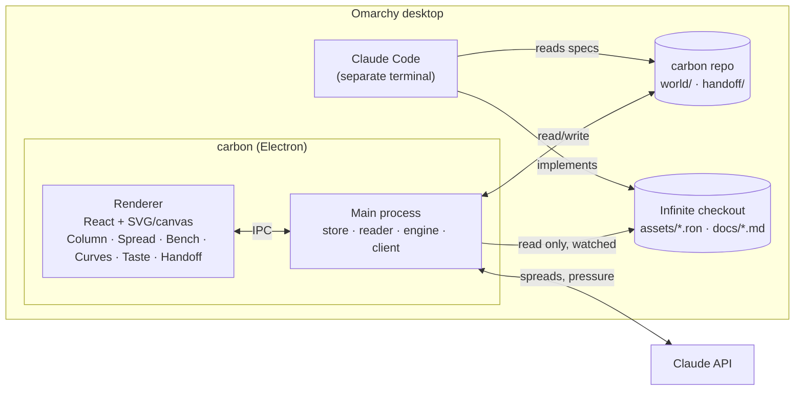

# Carbon: the system

How carbon is built. What the product does and why is in
[`PRODUCT.md`](PRODUCT.md); how it looks and behaves is in
[`EXPERIENCE.md`](EXPERIENCE.md).

---

## 1. Shape



There are three data sources with strict directions:

| Source | Carbon can | Never |
|---|---|---|
| Carbon's store (`world/`, `handoff/`) | read, write | n/a |
| Infinite checkout | read and watch | write, run, build |
| Claude API | send requests built by carbon, receive structured cards | tools, file access, agent loops |

## 2. Stack

- **Electron** with **Vite + React + TypeScript**. One window with no frame;
  Hyprland tiles it.
- **Rendering:** SVG for the Column, the spread field and curves (crisp at any
  zoom, easy hit-testing). Canvas only if the Column grows past a few thousand
  glyphs.
- **State:** a single in-memory store in the main process, mirrored to the
  renderer over IPC. Disk is the source of truth.
- **Launch:** `carbon` is a shell wrapper on `$PATH` that starts the app, or
  focuses its window if it's already open (`hyprctl dispatch focuswindow`).
- **Theme:** reads the active Omarchy theme
  (`~/.config/omarchy/current/theme/`) and maps it to CSS variables, falling back
  to a built-in dark palette. Reloads when the theme changes.
- **Config:** `carbon.toml` holds the path to the Infinite checkout, the model
  choices and the spend budget. The API key comes from the environment
  (`ANTHROPIC_API_KEY`) or the system keyring and is never stored in the repo.

## 3. The store: plain files in this repo

Everything carbon knows is a readable, diffable file. Git is the history.
Claude Code can read any of it directly.

```
world/
  cards/
    lantern-moth-jar.md      one file per card (frontmatter + prose)
    copper-set.md            imported "in game" cards for existing content
  spreads/
    2026-11-04T2114-low-sky-accessories-fill.json   every spread: request, candidates, triage
  taste.md                   rules (yours + canon) — edited in the Taste view or by hand
  patterns.json              patterns carbon noticed, with example card ids
  curves.json                intended curves (control points per band)
  decisions.log              append-only: time, card, from → to, why
handoff/
  2026-11-04-first-accessories.md
carbon.toml
```

### A card

```markdown
---
id: lantern-moth-jar
name: Lantern Moth Jar
lane: accessory
band: The Hollows
state: shaped            # idea | shaped | decided | handed | ingame | drift | graveyard
change: "Light follows you at walking pace and lingers where you've been for 30 s."
numbers: { light: 9, linger_s: 30 }
tradeoff: "Hollow creatures with positive menace track the lingering trail."
route:
  - { step: collect, what: "lantern moth", where: "Fungal forest, dark period" }
  - { step: craft, station: "clay kiln", with: ["clay jar", "binding"] }
relations: { conflicts: [glow-moss-band] }
origin: { spread: 2026-11-04T2114-hollows-accessories-fill, move: fill, by: claude }
edited_by_you: [tradeoff, route]
---

**Moment.** You've been lighting your way torch by torch; the first time the jar
fills, you turn around and see the path you came down still glowing.

**Why.** (required to mark decided)
```

The example content is a placeholder. It shows the format, not a design decision.

## 4. The Infinite reader

A read-only module that parses Infinite's data into a **digest**. It re-runs
when the checkout's files change (an fs watch on `assets/` and `docs/`) or `HEAD`
moves.

| Reads | For |
|---|---|
| `assets/strata_layers.ron`: band names, `bottom`/`top`, biome lists | The Column's bands |
| `assets/combat.ron`: `defense_k`, `max_health`, `regen`, `accessory_slots`, … | Curves; Bench consequences |
| `assets/blocks.ron`: `armor:`, `tool:` (`class`, `speed`, `tier`), `tooling:` | Existing items as *in game* cards; tiers |
| `assets/recipes.ron`: groups, stations, outputs | Routes; what's craftable |
| `assets/mobs.ron`: species, habitat bands, `menace` | The Threats lane |
| `docs/*.md`: headings and **canon** sentences carbon is told about | Canon rules in Taste, linked back to their source lines |

RON is parsed with a small tolerant parser that skips whatever it doesn't
understand and reports what it skipped. A broken Infinite file shows as a
warning in the status line, never a crash.

**Formula mirrors.** Carbon's consequence engine copies Infinite's formulas in
TypeScript, for example `taken = raw·k/(k+def)` and `TIER_GAP = 4`. Each mirror
records the Infinite file and symbol it copies (`Combat::mitigate`). The reader
warns when that file changes, so a stale mirror can't go unnoticed. Mirrors are
the only way carbon "knows" game code, and they are deliberately few.

## 5. Claude in carbon

### Where it's used

| Use | Trigger | Model class |
|---|---|---|
| **Spread** (all moves) | You, explicitly | Most capable Claude model |
| **Field placement**: scoring candidates on the chosen axes | Part of a spread | Same call, structured output |
| **Pressure** (judgement checks) | On open and after big changes, at most once an hour, cancellable | Fast small model |
| **Pattern noticing** from kills and keeps | After every 25 judgements | Fast small model |
| **Handoff drafting** | You, explicitly | Most capable model |

Nothing else. There is no chat endpoint.

### How a request is built

Every request is assembled in the same order. The stable parts come first so
prompt caching covers them.

```
┌ cached ───────────────────────────────────────────────┐
│ 1. Carbon's role & output schema                      │
│ 2. Infinite digest: bands, combat constants, tiers,   │
│    existing items, mobs, canon (from the reader)      │
│ 3. Taste: active rules + top patterns + kill reasons  │
│    with 2–3 examples each                             │
└───────────────────────────────────────────────────────┘
  4. The spot's neighbourhood: cards in this band and lane,
     ±1 band, related cards, graveyard ghosts at this spot
  5. Move instructions (fill / vary / oppose / alloy / …)
  6. Your direction (one line, optional)
  7. Diversity contract: N candidates, axes, 1 wildcard ignoring taste,
     no two candidates sharing a verb
```

The output is a JSON array of candidate cards, constrained by a tool or JSON
schema: name, change, numbers, trade-off, route sketch, moment, and an axis
score for each field axis. Carbon validates the cards and drops malformed ones.

### Cost

- Each spread shows its estimated cost before you run it, and its actual cost
  after.
- The status line has a budget meter against `budget_usd` in `carbon.toml`
  (default 100).
- Because of caching, follow-up spreads in the same session mostly pay for the
  neighbourhood, the move and the output.

## 6. Pressure checks

Notes in the Column's margin. Two kinds:

**Deterministic** (computed locally, free, instant):

- an empty lane over a run of bands
- depth/sky imbalance in each lane (canon: equal importance)
- clustering: several cards in one cell with the same verb
- curve drift: a card's numbers far from the intended curve at its band
- Sync drift: a decided card differs from Infinite's data
- dangling relations: references to killed or missing cards

**Judgement** (fast model, batched, cached):

- a card that's "just a number" (it has no verb)
- two cards that are the same idea under different names
- a card that breaks an active taste or canon rule

Every note says why it appeared and links to the cards involved. Notes can be
dismissed with a reason, and dismissals feed into taste.

## 7. Sync

For decided and handed cards, carbon looks for a matching id in Infinite's
data, using a naming convention (`infinite:<card-id>`) or an explicit
`infinite_id` in the card. A match moves the card to *in game*. If the game's
numbers differ from the card's, it moves to *drift* and shows a two-column
comparison. Resolving drift means one of two things, both done inside carbon:
update the spec, or accept the game's values.

## 8. Build plan

The design is meant to be built in slices. Each slice is usable on its own.

| Slice | Contains | Useful because |
|---|---|---|
| **0. Skeleton** | Electron shell, `carbon.toml`, Omarchy theme, store read/write, Infinite reader (bands, combat, armor, tools, mobs) | Infinite's progression appears as cards on its own |
| **1. Column** | Symlog axis, bands, lanes, card glyphs, navigation, Bench (read and edit) | You can see the whole progression and its gaps |
| **2. Spreads** | Request builder, fill/vary/oppose, field layout, triage keys, kill reasons, spread files | The core loop works |
| **3. Taste** | Taste view, canon import, rules toggle, pattern noticing | Spreads get better as you use them |
| **4. Curves** | Mitigation and budget curves, draggable intent, drift notes | Numbers are something you can feel |
| **5. Handoff + Sync** | Spec writer, handed/in game/drift states | The loop back to Claude Code is closed |
| **6. The rest** | Remaining moves, pressure (judgement), graveyard ghosts, cost meter polish | Depth |

**For one evening with parallel cloud sessions:** slice 0 goes first, in a single
session, because the other slices depend on its interfaces. Then three sessions
run in parallel: **Column**, **Spreads** (request builder plus field) and
**Bench + store editing**. Each works from this document and the mockups.
Slices 3 to 6 come later.

## 9. Testing

- **Reader:** fixture copies of Infinite's RON files, plus a test against the
  real checkout when `INFINITE_PATH` is set.
- **Formula mirrors:** table tests against the numbers in Infinite's docs (e.g.
  `ARMOR.md`'s "a 20-point hit lands for 17.9 / 17.2 / 16.1").
- **Request builder:** snapshot tests of the assembled request for each move.
- **UI:** Playwright against the Electron app for the triage keys and Column
  navigation.
