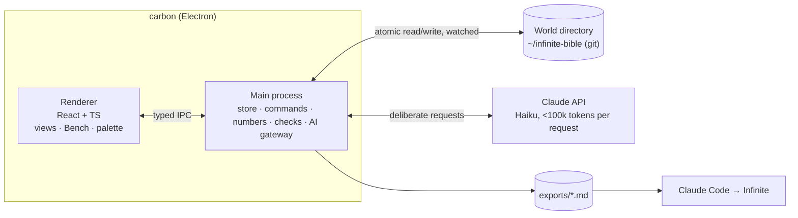

# Carbon: the system

How carbon is built. Product: [`PRODUCT.md`](PRODUCT.md). Behaviour:
[`EXPERIENCE.md`](EXPERIENCE.md). Build plan: [`BUILD.md`](BUILD.md).

---

## 1. Shape



- **The main process owns all state and all side effects.** The renderer is a
  view: it sends commands and receives state updates (snapshots, then patches).
- **Layers in `src/core`** (pure TypeScript, no Electron, no I/O): the domain
  model, schemas, commands, the numbers engine, mechanical checks, the context
  packer, the request builders. Everything here is unit-testable and always
  gives the same output for the same input.
- **`src/main`:** the store (files, git, watching), the AI gateway (SDK, cache,
  log), IPC.
- **`src/renderer`:** the UI.

## 2. Stack

| Concern | Choice |
|---|---|
| Shell | Electron, frameless, with `contextIsolation` and a typed preload bridge |
| Build | Vite + `electron-vite` (or an equivalent setup), TypeScript `strict` |
| UI | React; SVG for the Column, Climate, curves and spread field; a virtualised table for the Codex |
| Validation | zod schemas for every file, every IPC message and every AI output |
| AI | `@anthropic-ai/sdk`, model `claude-haiku-5-5`, structured outputs (`output_config.format`) |
| Tests | Vitest (unit and property tests with fast-check), Playwright `_electron` (end to end), recorded AI fixtures |
| Lint | ESLint + Prettier + `tsc --noEmit` in `npm run check` |

## 3. The domain model

### Entities

Every entity has **common fields**:

- `id` (a stable slug)
- `kind`
- `name`
- `identity` (a one-line fantasy)
- `description`
- `state`
- `why`
- `tags`
- `attributes` (named numbers)
- `relations`
- `origin` (whether you or the AI wrote it, and from which spread or suggestion)
- `ai_fields` (which fields still carry the `ai` marker)
- `created` and `updated`

Each kind adds its own fields:

| Kind | Kind-specific fields |
|---|---|
| `band` | `y_bottom`, `y_top` (either can be ±∞ for the endless ends), `character`, `danger` (a range), `air` / `light` / `hazard` notes |
| `biome` | `band`, `climate` (temperature and moisture rectangle, 0..1), `mood`, `ground`, `signature` |
| `material` | `properties` (named qualities), `rarity`, `processing` |
| `creature` | `temperament`, `menace` (−1..1), `behaviour`, `drops` |
| `structure` | `purpose`, `scale`, `rewards` |
| `capability` | `verb` (what the player can now do), `gates` (what it opens) |
| `item` | `subkind` (armor, accessory, tool, weapon, consumable), `slot`, `change`, `tradeoff`, `moment`, `route` (steps) |
| `feat` | `deed`, `reveal`, `unlocks` |

Kinds, fields and their requirements per state ("shaped needs identity, change
and tradeoff") come from **kind schemas in data** (`world/schema.json`), with
defaults built in. Adding a field never needs new code.

### Relations

Relations are typed and directed. Each type has a source kind, a target kind
and its own rules:

| Relation | Rule |
|---|---|
| `in_band` | entity → band |
| `in_biome` | entity → biome |
| `found_in` | material → biome or band |
| `lives_in` | creature → biome or band |
| `made_from` | item → material |
| `drops` | creature → material |
| `requires` | entity → capability or item |
| `unlocks` | feat → capability or slot |
| `counters` | item or capability → creature or hazard |
| `supersedes` | item → item; acyclic |
| `conflicts` | symmetric |
| `pairs_with` | symmetric |

Relation types are data too. The store enforces their rules (kinds, symmetry,
no cycles where declared) on every command.

### Placement

An entity's place on Y is its explicit band or biome if it has one. Otherwise
it's **inferred** from its relations, through a deterministic resolver (for
example, an item's place is the highest-danger place among the earliest steps
of its route). Inferred placement is marked as such and can be pinned by hand.

## 4. The store

```
~/infinite-bible/                ← world directory (its own git repo; path in settings)
  carbon.json                    format version, settings
  schema.json                    kinds, fields, relation types (overrides defaults)
  entities/<kind>/<id>.md        YAML frontmatter (validated) + markdown body
  numbers/variables.json
  numbers/formulas.carbon        the expression-language source
  taste/rules.json  taste/reasons.json  taste/patterns.json
  spreads/<timestamp>-<spot>.json
  ai-log/<date>.jsonl            every AI request: metadata, usage, cost (and the full request when debug is on)
  exports/<date>-<name>.md
```

- **Atomic writes:** write a temporary file, fsync, then rename. A crash never
  leaves a half-written entity.
- **Validation on load:** invalid files are quarantined and reported, never
  silently dropped. **Versioned migrations** upgrade older formats on open,
  with a backup first.
- **Git snapshots:** carbon commits the world directory every N minutes of idle
  time and on quit, with a generated message. History and recovery come for
  free.
- **External edits** (by hand or by Claude Code) are picked up by the file
  watcher. Conflicts with unsaved in-app edits ask you which to keep.

## 5. Commands and undo

Every change to the world is a **command**: `{type, payload}` → a validated
patch. Commands are applied in the main process, validated against schemas and
relation rules, persisted, and pushed to the renderer.

- The **undo stack** holds the inverse of each patch. Accepting an AI
  suggestion is a command like any other, so it undoes the same way.
- **Transactions** group several commands into one undo step (for example,
  merging candidates from a spread).
- Commands are pure functions in `src/core`, tested with property-based tests:
  applying a command then its inverse returns exactly the starting state, and
  applying any command leaves the world valid.

## 6. The numbers engine

A small expression language, parsed and evaluated **without `eval`**.

```
k = 100
base_health = 100
taken(raw, def) = raw * k / (k + def)
band_defense(b) = sum(items where subkind == "armor" and band == b, .defense)
ttk(c, w) = ceil(c.health / taken(w.damage, c.defense))
```

| Part | Contents |
|---|---|
| Values | Numbers, booleans, strings, entity references, lists |
| Operators | Arithmetic, comparison, `and`/`or`/`not` |
| Built-ins | `min`, `max`, `clamp`, `log`, `exp`, `pow`, `sqrt`, `floor`, `ceil`, `round`, `lerp`, `sum`/`count`/`avg` over entity queries |
| Pipeline | A Pratt parser produces an AST, then name resolution, then a type check, then a dependency graph with cycle detection, then incremental re-evaluation of what changed |
| Errors | Each has a precise source span (shown inline) and a fix hint where possible |
| Determinism | No randomness, no clock, no I/O; evaluation is bounded (step limit) |
| Tests | A golden test suite and property tests (parser round-trip, evaluation idempotence) |

## 7. Mechanical checks

These are pure functions of the world and run on every change, incrementally.
They're never AI.

- an empty lane over a run of bands, and depth/sky imbalance per lane
- a material found nowhere, a creature living nowhere, an unreachable item
  (its route needs things that don't exist)
- dangling or invalid relations, cycles in `supersedes`
- a required field missing for the entity's state
- formula errors, and an attribute far off its intent curve
- duplicate or near-duplicate names (normalised edit distance)

Each check produces notes with a stable id, the entities involved and their
height. A dismissed note stays dismissed until its inputs change.

## 8. The AI gateway

All AI goes through one module. Each request moves through these steps:

1. **Trigger:** one of the moments in `EXPERIENCE.md` §5. There are no other
   entry points.
2. **Build:** the request builder for that moment produces:
   - a **system prompt**: carbon's role and the moment's instructions
     (static, cached)
   - a **world digest**: compact summaries of the bands and biomes, plus counts
     and names per kind (changes slowly, cached)
   - **taste**: active rules, top patterns, kill-reason examples (changes
     slowly, cached)
   - **focus**: the entity being edited, its relation neighbourhood, the
     entities near it on the Column, and what the move or field asks for
     (changes per request, sent after the cache breakpoint)
3. **Pack:** the context packer ranks candidate entities by relevance (direct
   relations, then the same cell, then the same band, then the same kind, then
   recency) and fills a token budget (default 60k, hard limit 95k), choosing
   between full and summary renderings. Tokens are estimated locally; near the
   limit, carbon calls `count_tokens`. **No request goes over 100k tokens.**
4. **Cache:** the static and slow-changing parts come first and carry cache
   breakpoints. The cache key for the result is a hash of the canonical request
   plus the moment.
5. **Call:** `claude-haiku-5-5`, structured output with a JSON schema for each
   moment, streaming for spreads. Retries are typed (429, 5xx and network
   errors back off; 400s don't retry). Cancellation goes through an
   `AbortController`.
6. **Validate:** the output is parsed with zod against the moment's schema.
   Every entity it references must exist. Invalid items are dropped and
   counted, and never shown as if they were fine.
7. **Log:** a JSONL record with the moment, the entity, a hash of the request,
   usage (input, output, cache read and cache write tokens), cost, latency and
   the outcome.

**Budget:** the spend for the session and the month is computed from usage at
Haiku's prices (a pricing table in settings). When the budget is reached, the
AI pauses until you raise it.

**Without a key:** the AI is disabled, the surfaces say so, and everything else
works.

### Prompt evals

`evals/` holds seeded fixture worlds and, for each moment, a set of cases. The
deterministic metrics, run against the real API (`npm run eval`, cost reported
after each run):

| Metric | Target |
|---|---|
| Schema validity | 100% |
| References resolve to existing entities | 100% |
| No duplicates of existing names | ≥ 95% |
| Critique catches seeded flaws (a pure-number item, a duplicate, a rule break, a dangling relation) | recall ≥ 0.9 |
| Critique raises no notes on seeded clean entities | precision ≥ 0.8 |
| Spread diversity (pairwise name and verb overlap) | below a threshold |
| Every request under 100k tokens | always, with the cache read rate reported |

Prompt changes go in only if these metrics don't drop.

## 8a. Critique and generation agree

The writers (suggest, fill, spread) and the critic share one quality bar,
`src/core/prompts/quality.ts`. The critic judges by it, and every generating
prompt is told to meet it.

A "finished edit" critique runs only when a field **you** edited changed since
the baseline. Fields the AI wrote and you haven't touched don't count. The
critic is told which fields the AI wrote, and a note on such a field offers
**Rewrite**, which runs `suggest_one` with the note as guidance.

The eval's self-consistency metric (fill, then critique) holds this in place.
Details: `IMAGES.md` §7.

## 9. Testing

| Layer | How |
|---|---|
| `src/core` | Vitest unit tests and fast-check property tests (commands, numbers, checks, packer). Coverage ≥ 90% |
| Store | Tests on temporary directories: atomic writes, migrations, quarantining invalid files, external edits |
| AI gateway | Record/replay fixtures, so tests are deterministic and offline. Contract tests check the request shape for every moment |
| End to end | Playwright `_electron` under Xvfb: keyboard flows for every view, undo across AI accept, and a screenshot of each view |
| Performance | Column with 2,000 entities at ≥ 50 fps while panning; cold start < 2 s; a command's round trip < 16 ms |

`npm run check` runs the lint, the type check, the unit tests and the end-to-end
smoke test, and must pass before anything is merged.

## 10. Packaging for Omarchy

- `npm run dist` produces an AppImage, or an unpacked directory for running in
  place.
- `scripts/install-omarchy.sh` installs a `carbon` launcher on `$PATH` (which
  focuses the existing window if carbon is already running), a `.desktop`
  entry and a suggested Hyprland window rule.
- The API key comes from `ANTHROPIC_API_KEY` or the system keyring. It's never
  stored in the world directory.
